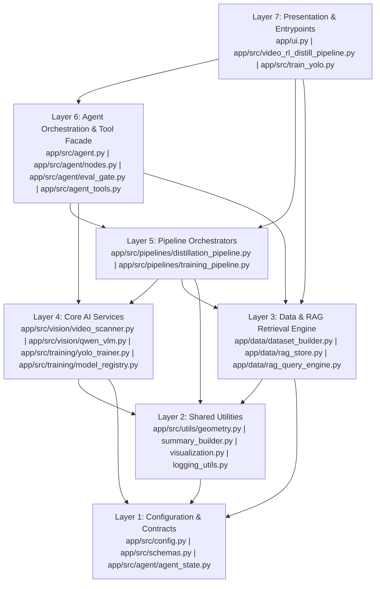

# Technical Architecture & Complete System Blueprint (`app/`)

> **Scope:** This document covers **every component strictly inside `app/`** — from individual constants, dataclass fields, regex parsers, and disk folder layouts up to the 3-stage multimodal vision pipeline, LangGraph Champion-Challenger HITL workflow, ChromaDB schema, Model Registry persistence, and Gradio 6 web dashboard.

---

## 1. High-Level Layered Architecture

The `app/` package is structured into **7 decoupled layers** with strict unidirectional dependencies (eliminating circular imports and enabling lazy loading of heavy GPU libraries like PyTorch, Ultralytics, and Transformers):



---

## 2. Layer 1 — Configuration & Data Contracts

### 2.1 `app/src/config.py`
Centralizes every system constant, threshold, and dataclass configuration:

- **Species Constants (must match YOLO `data.yaml`):**
  - `VALID_IMAGE_EXTS = {".jpg", ".jpeg", ".png", ".webp"}`
  - `CLASS_NAME_TO_ID = {"arabian_gazelle": 0, "arabian_oryx": 1}`
  - `CLASS_ID_TO_NAME = {0: "arabian_gazelle", 1: "arabian_oryx"}`
  - `SPECIES_DISPLAY_AR = {"arabian_gazelle": "الغزال العربي", "arabian_oryx": "المها العربي"}`
  - `DEFAULT_QWEN_MODEL_ID = "Qwen/Qwen3-VL-4B-Instruct"`

- **Execution Mode Truth Table (`RUN_MODE_FLAGS` & `resolve_mode_flags(run_mode)`):**
  - `RunModeType = Literal["display_only", "summary_only", "summary_with_rag", "summary_with_qwen", "train_only", "display_and_train"]`
  - Returns exact boolean flags: `display_video`, `export_buckets`, `run_qwen_verify`, `run_qwen_rag`, `run_yolo_training`, `generate_summary`.
  - Raises `ValueError` for unknown mode names.

- **Dataclasses:**
  1. `VideoScanConfig`:
     - `yolo_weights: str`, `run_mode: RunModeType = "train_only"`
     - `conf_min: float = 0.15` (low recall-mining threshold during Stage 1 scan)
     - `conf_review_thresh: float = 0.95` (tracks `< 0.95` routed to `qwen_review_below_95/`)
     - `trusted_rag_min_conf: float = 0.75` (tracks `>= 0.75` routed to `trusted_rag_above_75/`)
     - `purity_review_thresh: float = 0.80` (tracks with inconsistent class votes routed to Qwen review)
     - Adaptive frame skipping: `idle_stride = 30`, `active_stride = 5`, `cooldown_frames = 60`, `motion_thresh = 500`
     - Tracker params: `track_activation_floor = 0.20`, `minimum_iou_threshold = 0.20`, `lost_track_buffer_sec = 2.0`
     - Runtime options: `audit_all = False`, `save_bucket_debug = True`, `display_window_name`, `use_half = True`
  2. `QwenVLMConfig`:
     - `model_id = "Qwen/Qwen3-VL-4B-Instruct"`, `lora_dir: Optional[str] = None`
     - Token/image limits: `min_pixels = 256*28*28`, `max_pixels = 512*28*28`, `batch_size = 8`, `zoom_scale = 3.0`
     - Generation limits: `classification_max_new_tokens = 96`, `description_max_new_tokens = 512`
     - `use_adapter_for_description: bool = False` (ensures `model.disable_adapter()` runs during RAG captioning)
  3. `RAGDescriptionConfig`:
     - `enabled = True`, `language: Literal["ar", "en", "bilingual"] = "ar"`
     - `trusted_only = True`, `include_empty_or_rejected = False`, `flag_count_mismatch = True`
     - `temporal_frames_per_track = 3`, `max_image_dim = 512`, `output_filename = "rag_documents.jsonl"`
     - `chromadb_dir: Optional[Path] = None`, `chromadb_collection = "arabian_wildlife_rag"`
  4. `PipelineConfig`:
     - Wraps `out_dataset_dir`, `video_scan`, `qwen`, `rag`, `run_stage2_distill`, `save_debug`
     - Computed properties:
       - `staging_dir` → `<out_dataset_dir>/_staging`
       - `qwen_review_bucket_dir` → `<out_dataset_dir>/qwen_review_below_95`
       - `trusted_rag_bucket_dir` → `<out_dataset_dir>/trusted_rag_above_75`
  5. `WandbConfig`:
     - Reads `WANDB_API_KEY`, `WANDB_BASE_URL`, `WANDB_ENTITY`, `WANDB_PROJECT` strictly from environment variables (zero hardcoded secrets).
  6. `TrainingConfig`:
     - Dataset paths (`orig_dataset`, `qwen_dataset`, `merged_dataset`), `baseline_weights`, `project_dir`, `version_tag`, `run_name`
     - Hyperparameters (`replay_samples=400`, `seed=42`, `epochs=25`, `imgsz=640`, `batch=16`, `optimizer="AdamW"`, `lr0=0.0002`, `lrf=0.05`, `cos_lr=True`, `warmup_epochs=0.0`, `patience=8`, `mosaic=0.2`, `close_mosaic=10`, HSV/flip/scale augmentations)
     - Evaluation & Registry params (`diff_conf_thresh=0.25`, `fp_conf_thresh=0.25`, `fp_frame_stride=10`, `eval_split="test"`, `archive_dataset_zip=True`, `models_dir`, `registry_path`, `model_id`, `parent_model_id`).

---

### 2.2 `app/src/schemas.py`
Defines all serializable contracts flowing across stages:

- **`DetectionBox`**: `track_id`, `class_id`, `species`, `conf`, `xyxy: List[int]`.
- **`TrackRecord`** (in-memory accumulator during Stage 1):
  - Temporal bounds: `start_time_sec`, `end_time_sec`, `start_frame`, `end_frame`, `best_frame`, `best_time_sec`
  - Confidence & voting: `max_conf`, `confidences`, `class_votes`, `best_bbox`, `all_frame_boxes`
  - O(1)-RAM 3-frame disk pointers: `first_frame_path` (`f1_start`), `raw_image_path` (`f2_best`), `last_frame_path` (`f3_end`), `last_saved_frame_idx`.
- **`TrackManifestItem`** (persisted in `track_manifest.json`):
  - Full video/frame/timestamp coordinates (`video_tag`, `video_source`, `track_id`, `start_frame`, `end_frame`, `best_frame`, `start_hms`, `end_hms`, `best_hms`, `fps`)
  - Confidence metrics (`avg_conf`, `max_conf`, `min_conf`, `class_purity`)
  - Routing flags (`needs_rl_review`, `is_trusted_for_rag`)
  - Bucket artifact paths (`review_bucket_{image,label,debug}_path`, `trusted_bucket_{image,label,debug}_path`)
  - Temporal 3-frame paths (`temporal_frame_paths`, `temporal_frame_indices`, `trusted_temporal_frame_paths`)
  - Stage 2 Qwen enrichment (`qwen_verified`, `qwen_species`, `verified_species_counts`, `distilled_image_path`, `distilled_label_path`).
- **`VLMClassificationResult`**: `species`, `raw_text`, `parsed_ok`.
- **`SceneDescriptionResult`**: `description_ar`, `description_en`, `estimated_time_of_day`, `environment_type`, `animal_states`, `background_elements`, `visibility_quality`, `observed_counts`, `raw_text`, `parsed_ok`.
- **`RAGMetadata`** & **`RAGDocument`**:
  - Flat numeric counts (`oryx_count`, `gazelle_count`, `other_animals_count`, `total_animals`), species lists, temporal/frame fields, confidence/purity, `needs_review` + `review_reasons`, environmental & behavioral tags, `temporal_frames_used`, `temporal_frame_paths`.
  - **`to_chromadb_record()`**: strictly enforces ChromaDB's primitive metadata rule (`str | int | float | bool` ONLY — converts lists to `*_csv`, booleans like `has_oryx`/`has_gazelle`, and replaces `None` with `"unverified"`).
- **`RAGQueryFilter`**: 22 optional filter fields covering video, species, count ranges, confidence ranges, purity, review flag, verification status, time of day, environment, animal states, visibility, frame ranges, timestamp ranges, and substring match.

---

### 2.3 `app/src/agent/agent_state.py`
Defines the LangGraph-serializable state (`TypedDict`) without ever storing raw PyTorch/YOLO model objects inside graph checkpoints:

- **`MetricsSnapshot`**: `precision`, `recall`, `mAP50`, `fp_per_hour`.
- **`WildlifeAgentState`**:
  - Mode & summary: `run_mode`, `should_run_pipeline`, `video_summary`, `video_summary_markdown`, `video_summary_path`
  - Workspace & RAG paths: `video_paths`, `out_workspace_dir`, `qwen_review_dir`, `trusted_rag_dir`, `qwen_distilled_dir`, `rag_jsonl_path`, `chromadb_dir`, `chromadb_collection`
  - Training & Registry paths: `orig_dataset_dir`, `merged_dataset_dir`, `train_project_dir`, `train_run_dir`, `qwen_lora_dir`, `version_tag`, `registry_path`, `models_dir`, `active_champion_model_id`, `challenger_model_id`
  - Model paths & Gate fields: `champion_weights_path`, `challenger_weights_path`, `eval_yaml_path`, `held_out_video_path`, `champion_metrics`, `challenger_metrics`, `champion_points`, `challenger_points`, `gate_decision`, `gate_reason`, `engineer_override`.
- **`load_yolo_cached(weights_path: str)`**: `@lru_cache(maxsize=2)` with lazy `from ultralytics import YOLO` import inside the function so importing state schemas is instantaneous (<5ms).

---

## 3. Layer 2 — Shared Utilities (`app/src/utils/`)

| File | Key Functions | Responsibility |
|---|---|---|
| `logging_utils.py` | `get_logger(name, level)` | Uniform timestamped logging without duplicate root handlers. |
| `geometry.py` | `format_hms`, `norm_species`, `sanitize_tag`, `xyxy_to_yolo`, `build_zoomed_visual_prompt`, `prepare_full_frame_pil` | Pixel-to-YOLO coordinate conversion, 3x contextual zoom cropper with temporary red target box (`<= 768px`) for Qwen classification, and full-frame RGB PIL thumbnail resizing. |
| `visualization.py` | `save_track_bucket_debug`, `save_side_by_side_qwen_debug`, `save_model_disagreements` | Renders annotated bucket debug frames (`QWEN_REVIEW` vs `TRUSTED_RAG`), YOLO-vs-Qwen side-by-side panels, and Champion-vs-Challenger test-set disagreement panels (flagged when class counts differ or avg conf shifts `> 0.20`). |
| `summary_builder.py` | `classify_speedup_level`, `compute_processing_performance`, `build_video_summary`, `render_video_summary_markdown` | Computes video duration vs actual processing time, `speedup_factor`, `time_saved_hms`, `time_reduction_pct`, Arabic/English improvement tiers (`>=10x` exceptional, `>=5x` excellent, `>=2x` good, `>=1x` realtime, `<1x` slower), per-species breakdown, grand totals, overall avg/min/max confidence, and chronological appearance table with exact frame indices. |

---

## 4. Layer 3 — Data Curators, RAG Store & Hybrid Search (`app/data/`)

### 4.1 `app/data/dataset_builder.py`
- `clean_orphan_labels(images_dir, labels_dir)`: Deletes `.txt` files missing a paired image.
- `copy_pair(...)`: Copies image + label (creating empty `.txt` for hard negatives).
- `build_merged_dataset(...)`: Combines Qwen-verified hard positives/negatives (`qwen_` prefix) with a deterministic seeded replay buffer of original training images (`orig_` prefix), copies `val/` and `test/` splits unchanged, and writes `data_{version}.yaml`.

### 4.2 `app/data/rag_store.py`
- `build_rag_document(track, scene, ...)`:
  - Reconciles Stage 2 verified counts (when available) with Stage 1 detector counts and Qwen observed counts.
  - Auto-populates `review_reasons`: `low_confidence`, `low_class_purity`, `qwen_rejected_false_positive`, `vlm_description_parse_fallback`, `visibility_{blurry|low_light|distant}`, and `vlm_detector_count_mismatch`.
  - Prepends a deterministic grounded header (video name, best frame, appearance window `start_hms -> end_hms`, peak `best_hms`, counts, time of day, confidence, review status) to Qwen's narrative in Arabic (`text_ar`) and English (`text_en`).
  - Records `temporal_frames_used` and `temporal_frame_paths`.
- Persistence & Filtering:
  - `save_rag_documents_jsonl`, `load_rag_documents_jsonl`, `export_vector_db_payloads`
  - `filter_rag_documents(docs, RAGQueryFilter)` and `summarize_rag_corpus(docs)`
  - `upsert_rag_documents_to_chromadb(docs, persist_dir, collection_name)` using `doc.to_chromadb_record()`
  - `query_chromadb_rag(persist_dir, query_text, collection_name, where_filter, n_results)`

### 4.3 `app/data/rag_query_engine.py`
Bilingual Arabic/English natural-language RAG query parser and hybrid search engine:
- **`normalize_arabic_text`**: Converts Eastern Arabic numerals (`٠-٩`), strips diacritics/tatweel, normalizes `أ/إ/آ -> ا`, `ة -> ه`, `ى -> ي`.
- **`parse_natural_rag_query(query_text)`**:
  - Extracts species (`غزال/غزلان/الريم/gazelle`, `مها/وضيحي/oryx`) + cardinal counts & Arabic dual forms (`ستة غزلان` → `min_gazelle_count=6`, `غزالين` → `min_gazelle_count=2`).
  - Maps time-of-day phrases (`النهار` → `["morning", "midday", "afternoon"]`, `الليل` → `["night"]`, `الصباح`, `الظهر`, `العصر`, `الفجر`, `الغروب`).
  - Extracts behavior & environmental concepts with bilingual synonym groups (`تحت الشجرة` → `["شجر", "شجره", "اشجار", "ظل", "tree", "acacia", "shrub", "shade"]`, plus dunes, rocky hills, waterhole, grazing, running, walking, resting, alert, fence, vehicle).
  - Detects review intent (`صور تحتاج مراجعة` → `needs_review=True`).
- **`search_wildlife_rag(...)`**:
  - Converts filters to a ChromaDB `where` dict (`$and`, `$gte`, `$lte`, `$eq`, `$in`) and queries ChromaDB when present.
  - Falls back cleanly to JSONL hybrid search (`filter_rag_documents` + concept/keyword relevance & count-exactness scoring).
  - Returns `answer_markdown`, structured `matches`, and Gradio-ready `gallery_items` (`[(image_path, caption), ...]`).

---

## 5. Layer 4 — Core AI Services (`app/src/vision/` & `app/src/training/`)

### 5.1 `app/src/vision/video_scanner.py`
- **`VideoScanner.scan_videos(...)`**:
  - Uses `cv2.createBackgroundSubtractorMOG2(history=500, varThreshold=25, detectShadows=False)` at `320x180` during idle mode (`idle_stride=30`); upon motion/detection switches to `active_stride=5` for `cooldown_frames=60`.
  - Runs FP16 YOLO (`half=True` on CUDA) + `ByteTrackTracker`.
  - Captures up to **3 chronological frames** directly on disk (`f1_start`, `f2_best`, `f3_end`) without holding images in RAM (`collect_chronological_track_frames` deduplicates & sorts chronologically).
  - Supports live OpenCV overlay rendering (`_render_live_overlay`) for `display_only` and `display_and_train` (gracefully degrades to headless if no GUI is available).
  - Exports **two structured buckets** (whenever `export_buckets=True`):
    ```text
    <out_dir>/
    ├── qwen_review_below_95/        # avg_conf < 0.95 OR purity < 0.80 OR audit_all
    │   ├── images/<stem>.jpg        # Raw unmodified frame
    │   ├── labels/<stem>.txt        # Normalized YOLO labels
    │   └── debug/<stem>_debug.jpg   # Annotated inspection frame
    └── trusted_rag_above_75/        # avg_conf >= 0.75
        ├── images/<stem>.jpg        # Best frame
        ├── images/<stem>_t1..t3.jpg # Up to 3 chronological frames for Qwen RAG
        ├── labels/<stem>.txt
        └── debug/<stem>_debug.jpg
    ```
    Tracks in `[0.75, 0.95)` intentionally land in **both** buckets: reliable enough for ChromaDB scene indexing while still audited by Qwen GRPO to keep sharpening YOLO.

### 5.2 `app/src/vision/qwen_vlm.py`
- **`QwenWildlifeVLM`** (context-managed single GPU load, `bfloat16`/`float16`, left-padded tokenizer for batched generation):
  1. **`classify_crops_batch(zoomed_images)`**:
     - Runs with **PEFT GRPO LoRA enabled** on 3x zoomed crops with a temporary red target box.
     - Parses `<answer>{"species": "arabian_oryx" | "arabian_gazelle" | "none"}</answer>`.
  2. **`describe_scenes_batch(frame_groups, scene_contexts)`** & **`describe_track_for_rag(model, processor, frame_paths, species, ...)`**:
     - Accepts **1 to 3 chronological frames** resized to `<= 512x512` (`Image.Resampling.LANCZOS`).
     - Builds multi-image chat content `*[{"type": "image"} for _ in imgs]`.
     - Wraps `model.generate(...)` inside **`with model.disable_adapter():`** (when `use_adapter_for_description=False`) to run Base Qwen3-VL with **zero additional VRAM**, avoiding classification-LoRA bias while capturing animal movement across frames.
     - Parses `<description>{...}</description>` with a 3-tier resilient JSON extractor (`<description>`, fenced JSON, outermost `{...}`, plus raw-text fallback).

### 5.3 `app/src/training/model_registry.py` & `app/registry.json`
- **`ModelRegistry(registry_path, models_dir)`**:
  - Atomic writes (`registry.json.tmp` → `replace()`) to prevent corruption.
  - Manages `app/models/<model_id>.pt` checkpoints and stores: `active_champion`, `previous_champion`, `models_dir`, `updated_at`, `models[]`, and `history[]`.
  - Operations:
    - `register_trained_model(...)`: copies weights into `app/models/`, registers entry with `status="candidate"` + `training_metadata`.
    - `record_evaluation(...)`: persists `MetricsSnapshot` and gate scorecard.
    - `promote_model(...)`: verifies `.pt` exists, archives current `active_champion` into `previous_champion`, promotes new model to `status="champion"`.
    - `reject_model(...)`: marks candidate `status="rejected"`, leaves `active_champion` untouched.
    - `rollback(target_model_id=None, reason=...)`: restores `previous_champion` (or a specified archived model), marks failed active model `status="rolled_back"`, logs audit entry in `history`.

### 5.4 `app/src/training/yolo_trainer.py`
Cleanly split into independent training and evaluation functions:
- **`configure_wandb_env(WandbConfig)`**: Safe env-only W&B setup (`WANDB_DISABLED=true` if no API key).
- **`YOLOTrainer.train(data_yaml_path)`**: Fine-tunes from Champion weights, exports weights into `app/models/` via `ModelRegistry.register_trained_model(...)`, optionally archives merged dataset ZIP, returns `challenger_model_id` & `challenger_weights_path`.
- **`compute_fp_per_hour(model, held_out_video_path, conf_thresh, frame_stride)`**: Measures false positives per hour on an empty held-out negative video.
- **`evaluate_single_model(...)`**: Loads via `load_yolo_cached`, runs `model.val(split=...)` + `compute_fp_per_hour`, returns `MetricsSnapshot`.
- **`evaluate_champion_vs_challenger(...)`**: Evaluates both checkpoints, saves disagreement debug images and JSON comparison report, returns `champion_metrics` + `challenger_metrics`.

---

## 6. Layer 5 — Pipeline Orchestrators (`app/src/pipelines/`)

- **`distillation_pipeline.py`**:
  - `run_qwen_distillation(...)`: Stage 2 GRPO verification over `needs_rl_review` tracks; writes clean raw full frames + corrected YOLO `.txt` labels + side-by-side `POS`/`NEG` debug frames.
  - `run_qwen_rag_description(...)`: Stage 3 3-frame Qwen scene description over `is_trusted_for_rag` (`>= 0.75`) tracks; builds `RAGDocument`s, writes `rag_documents.jsonl`, and upserts to ChromaDB when `chromadb_dir` is set.
  - `run_distillation_and_rag_pipeline(...)`: Resolves `resolve_mode_flags(run_mode)`, shares a single `QwenWildlifeVLM` context across Stage 2 & Stage 3, always builds `video_summary` (persisting `video_summary.json` and `video_summary.md` except in zero-write `display_only` mode), and outputs `pipeline_report.json` + `track_manifest.json`.
- **`training_pipeline.py`**:
  - `run_training_stage(TrainingConfig)`: Dataset merge + `YOLOTrainer.train()`.
  - `run_evaluation_stage(...)`: Champion-vs-Challenger evaluation + `MetricsSnapshot` generation.
  - `run_training_pipeline(...)`: Convenience sequential wrapper.

---

## 7. Layer 6 — LangGraph Agent & Tool Facade (`app/src/agent/`, `app/src/agent.py`, `app/src/agent_tools.py`)

### 7.1 `app/src/agent/eval_gate.py`
- **`eval_gate_node(state: WildlifeAgentState)`**:
  1. **Hard Guardrails (`MAX_DROP = 0.02`)**: If `challenger` drops more than `0.02` below `champion` on `precision`, `recall`, or `mAP50`, immediately returns `gate_decision="needs_hitl"` with exact breach reason.
  2. **Weighted Scorecard**: `precision` (`1 pt`), `recall` (`1 pt`), `mAP50` (`1 pt`), `fp_per_hour` (`2 pts`, lower is better).
  3. Promotes automatically (`gate_decision="promote"`) only if `challenger_points > champion_points` with all guardrails intact; otherwise escalates to `needs_hitl`.

### 7.2 `app/src/agent/nodes.py`
- `ingest_video_node`: Maps `WildlifeAgentState` → `PipelineConfig`, runs `run_distillation_and_rag_pipeline`, writes `video_summary`, `video_summary_markdown`, bucket paths, and `should_run_pipeline`.
- `route_after_ingest`: Returns `"train"` **only** when `resolve_mode_flags(run_mode)["run_yolo_training"]` is `True`; otherwise `"end"`.
- `train_node`: Calls `run_training_stage`, updates `challenger_model_id`, `challenger_weights_path`, `eval_yaml_path`, `train_run_dir`.
- `evaluate_node`: Calls `run_evaluation_stage`, logs `challenger_metrics` to `ModelRegistry`, writes `champion_metrics` and `challenger_metrics`.
- `promote_or_reject_node`: Commits final gate decision (or engineer HITL override) into `app/registry.json` via `promote_model` or `reject_model`.

### 7.3 `app/src/agent/graph.py` & `app/src/agent.py`
- `hitl_review_node` & `route_after_eval_gate`: Handles HITL escalation (`interrupt_before=["hitl_review"]`).
- `build_wildlife_graph(checkpointer, interrupt_on_hitl)`: Compiles the LangGraph `StateGraph(WildlifeAgentState)` with `MemorySaver`.
- `WildlifeAgentRunner`: Unified runner supporting native LangGraph `StateGraph` (with seamless in-process state-machine fallback if `langgraph` is not yet installed), exposing `.run(state, thread_id)`, `.resume_hitl(thread_id, engineer_override)`, `.query_rag(query_text, **kwargs)`, and `.rollback_champion(...)`.
- `get_graph_mermaid()`: Returns the exact Mermaid flowchart of the agent graph.
- `app/src/agent/__init__.py`: Uses PEP 562 `__getattr__` lazy exports so `from app.src.agent import WildlifeAgentRunner` works cleanly without triggering circular imports when `yolo_trainer.py` imports `app.src.agent.agent_state`.
- `app/src/agent.py`: Runnable CLI entrypoint (`python app/src/agent.py --mermaid` or `--video_paths ... --run_mode ...`) delegating to `app/src/agent/graph.py`.

### 7.4 `app/src/agent_tools.py`
12 JSON-serializable tool wrappers ready for MCP, LangGraph ToolNode, Google ADK, or OpenAI Agents SDK:
- Video & VLM: `tool_scan_wildlife_videos`, `tool_run_distillation_and_rag`, `tool_describe_track_frames`, `tool_describe_wildlife_image`
- RAG & ChromaDB: `tool_query_rag_documents`, `tool_index_rag_jsonl_to_chromadb`, `tool_query_chromadb_rag`, `tool_get_rag_corpus_summary`
- Split Train/Eval & Registry: `tool_train_yolo`, `tool_evaluate_champion_vs_challenger`, `tool_train_incremental_yolo`, `tool_get_active_champion`, `tool_list_registered_models`, `tool_promote_model`, `tool_rollback_model`.

---

## 8. Layer 7 — Gradio 6.4+ Dashboard & CLI Entrypoints

### 8.1 `app/ui.py`
Built specifically for **Gradio 6.4+** (passing `theme`, `css`, and `allowed_paths` to `demo.launch(...)` so local disk images load safely in `gr.Gallery`):
- **Tab 1 — RAG Wildlife Search**: Natural-language query box + Arabic quick examples + advanced filter accordion (JSONL/ChromaDB paths, species, min counts, time of day, min confidence, review filter, 3-frame gallery toggle) → renders grounded Arabic Markdown answer, live `gr.Gallery` displaying images from disk paths with video/time/frame captions, and structured `gr.Dataframe`.
- **Tab 2 — LangGraph Agent & Summary**: Video path input / file uploader, 6-option `run_mode` selector, auto-loaded Champion weights from `app/registry.json`, optional training/ChromaDB accordion → renders live Arabic processing-speedup & sighting summary, JSON gate status, and **HITL Approve / Reject buttons** wired to `runner.resume_hitl(thread_id, ...)`.
- **Tab 3 — Model Registry & Rollback**: Displays active/previous Champion cards, full registered models metrics table, one-click Promote, one-click Rollback to previous/selected model, and expandable LangGraph Mermaid topology.

### 8.2 CLI Entrypoints
- **`app/src/video_rl_distill_pipeline.py`**: Accepts `--run_mode` (all 6 modes), `--conf_review_thresh` (`0.95`), `--trusted_rag_min_conf` (`0.75`), `--chromadb_dir`, `--rag_language`, and prints both the formatted Arabic summary and compact JSON report.
- **`app/src/train_yolo.py`**: Accepts `--stage {train,eval,both}`, `--champion_weights`, `--challenger_weights`, `--eval_yaml`, `--held_out_video`, `--model_id`, `--models_dir`, and `--registry_path`.

---

## 9. Storage Artifacts Summary

| Artifact | Location | Purpose |
|---|---|---|
| Trained YOLO checkpoints | `app/models/<model_id>.pt` | Versioned weights managed by `ModelRegistry` |
| Model Registry | `app/registry.json` | Active/previous Champion, metrics, gate decisions, rollback audit log |
| Qwen Review Bucket (`< 0.95`) | `<out>/qwen_review_below_95/{images,labels,debug}` | Uncertain detections for Qwen GRPO audit → YOLO training |
| Trusted RAG Bucket (`>= 0.75`) | `<out>/trusted_rag_above_75/{images,labels,debug}` | Trusted detections + 3 chronological frames (`_t1..t3`) → Qwen description → ChromaDB |
| Track Manifest | `<out>/track_manifest.json` | Full per-track metadata, frame indices, and bucket paths |
| RAG Corpus | `<out>/rag_documents.jsonl` | Bilingual embeddable wildlife descriptions + rich filterable metadata |
| Persistent Vector Store | `<chromadb_dir>/` | ChromaDB collection (`arabian_wildlife_rag`) with primitive filter metadata |
| Video Summaries | `<out>/video_summary.json` & `video_summary.md` | Speedup factor, improvement tier, species counts, confidence, and frame timeline |
| Pipeline Report | `<out>/pipeline_report.json` | Stage-by-stage execution telemetry |
