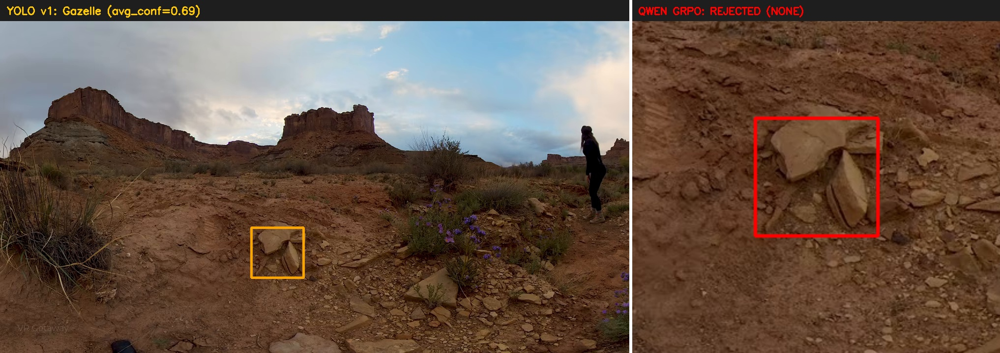
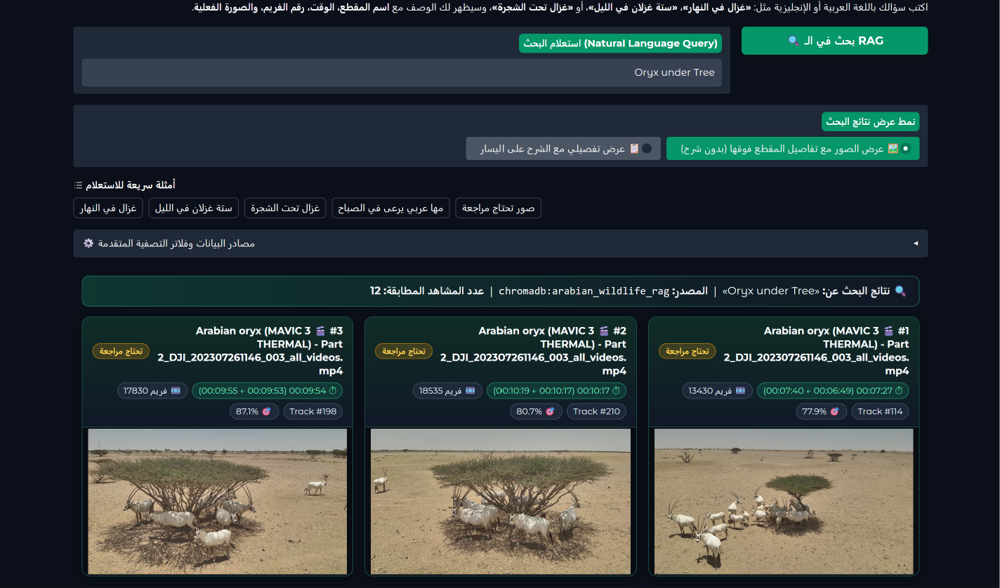
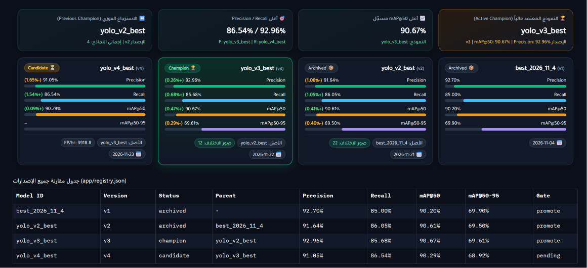
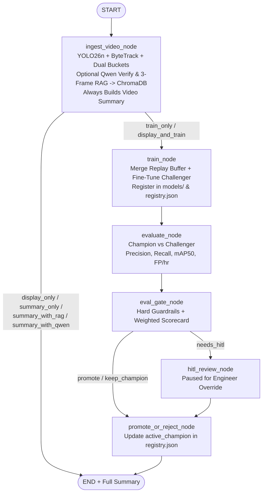

<div align="center">

# 🦌 Arabian Wildlife Agentic Vision, Distillation & RAG System

**End-to-End Agentic Computer Vision, GRPO VLM Distillation, Bilingual Arabic/English Multimodal RAG & Champion-Challenger MLOps Platform**

[](https://www.python.org/)
[](https://docs.ultralytics.com/)
[](https://huggingface.co/Qwen)
[](https://langchain-ai.github.io/langgraph/)
[](https://www.trychroma.com/)
[](https://www.gradio.app/)
[](LICENSE)

</div>

---

## 🎬 Live System Demo

> **Live End-to-End Walkthrough:** Adaptive YOLO26n + ByteTrack tracking, interactive playback controls, Qwen3-VL 3-frame RAG search, and Model Registry governance.

<!--
📌 GITHUB UPLOAD PLACEHOLDER:
Open README.md in GitHub's web editor and drag-and-drop `assets/Arabian Wildlife Al Agent.mp4`
directly here to replace this comment with GitHub's native HD video embed:
https://github.com/user-attachments/assets/<your-video-id>
-->

---

An end-to-end **Agentic Computer Vision & Multimodal RAG** platform engineered for automated monitoring of **Arabian Oryx (المها العربي)** and **Arabian Gazelle (الغزال العربي)** across drone and camera-trap footage.

The system combines adaptive-stride **YOLO26n + ByteTrack** scanning, **dual confidence-bucket routing**, **Qwen3-VL-4B GRPO LoRA verification** via Zoomed Visual Prompting, **3-frame chronological scene description** (with zero-VRAM adapter toggling), **bilingual Arabic/English semantic RAG search** over **ChromaDB & JSONL**, a **LangGraph Champion-Challenger HITL training loop**, an atomic **Model Registry with 1-click rollback**, and a **Gradio 6.4+ RTL Web Dashboard**.

---

## ✨ Key Capabilities

| Capability | Description |
|---|---|
| **Adaptive Video Scanner** | MOG2 motion gating + adaptive idle/active frame skipping (`30x` idle / `5x` active) with **ByteTrack** multi-object tracking and O(1)-RAM 3-frame chronological capture (`start`, `best`, `end`). |
| **Dual Confidence Buckets** | Automatically routes tracks `< 0.95` to `qwen_review_below_95/{images,labels,debug}` for Qwen GRPO training distillation, and tracks `>= 0.75` to `trusted_rag_above_75/{images,labels,debug}` for 3-frame RAG captioning → **ChromaDB**. |
| **6 Execution Modes (`run_mode`)** | `display_only`, `summary_only`, `summary_with_rag`, `summary_with_qwen`, `train_only`, and `display_and_train` — every mode produces a full Arabic & JSON summary with species counts, confidence, frame timestamps, and speedup metrics. |
| **Zero-VRAM Adapter Switching** | Loads `Qwen/Qwen3-VL-4B-Instruct` **once**: enables GRPO LoRA for closed-set species verification (`arabian_oryx`, `arabian_gazelle`, `none`), then calls `model.disable_adapter()` to describe **3 chronological frames** with Base Qwen3-VL. |
| **Bilingual Arabic/English RAG Search** | Natural-language queries such as `مها تحت الشجرة`, `Oryx under Tree`, `ستة غزلان في الليل`, or `غزال تحت الشجرة` extract species counts, time of day, behavior, and habitat filters, returning grounded answers with **video name, timestamps, frame numbers, and actual scene images**. |
| **LangGraph Agent + HITL Eval Gate** | Orchestrates `ingest_video → train → evaluate → eval_gate → [hitl_review] → promote_or_reject` with hard guardrails (`max drop <= 0.02`), weighted scorecard (`FP/hr` weight `2x`), and human-in-the-loop interruption. |
| **Model Registry & Rollback** | Atomically tracks every trained checkpoint in `models/` and `registry.json` (`active_champion`, `previous_champion`, metrics, gate scorecard, history) for instant 1-click rollback. |
| **Gradio 6.4+ Dashboard** | Full RTL-friendly web UI (`ui.py`) featuring visual RAG scene cards / detailed view toggle, live display Standard vs. Clean Demo mode selector, LangGraph HITL controls, and Model Registry benchmark dashboards. |

---

## 📊 Benchmarks & Experimental Results

### 1. Adaptive Scanning & VLM Throughput (NVIDIA L4 22.5 GB)

| Pipeline Stage | Configuration | Throughput / Runtime | Key Result |
|---|---|---|---|
| **Stage 1 — Adaptive Scanner** | `YOLO26n FP16` + MOG2 Motion Gating + Adaptive Stride | **`420–1,339 FPS`** | 177-min desert footage scanned in **`2.6 min`** (**`66.5x`** real-time) |
| **Stage 2 — VLM Verification** | `Qwen3-VL-4B GRPO` (`bfloat16`, Batch-8) | **`0.33 s/frame`** | **`256`** uncertain tracks audited in **`90s`**, **`0`** parse errors |

### 2. Reinforcement Learning Fine-Tuning (`Qwen3-VL-4B`: Base vs. GRPO LoRA)

Evaluated on the **40-image held-out validation split** using structured JSON output verification and spatial localization reward optimization:

| Model Variant | Valid JSON | Species Acc | Hard-Neg Rejection | Positive mIoU | Det@0.5 |
|---|:---:|:---:|:---:|:---:|:---:|
| `Qwen3-VL-4B` (Base) | `100%` | `97.5%` | `100%` | `0.6983` | `80.00%` |
| **`Qwen3-VL-4B` (GRPO LoRA)** | **`100%`** | **`97.5%`** | **`100%`** | **`0.7332 (+3.49%)`** | **`83.33% (+3.33%)`** |

<p align="center">
  
  <br />
  <sub><b>Zoomed Visual Prompting (3x Crop + Red Target Box):</b> YOLO v1 flags desert rocks as an Arabian Oryx at <code>0.69</code> confidence (left); Qwen3-VL-4B GRPO inspects the 3x zoomed context window and rejects the false positive as <code>NONE</code> (right), automatically feeding hard negatives back into replay-buffered YOLO distillation.</sub>
</p>

### 3. Champion-Challenger Evolution (`YOLO26n` — 190-Image Test Split, 481 Instances)

Metrics below match the live versioned audit log in [`registry.json`](registry.json):

| Version | Model ID | Status | Precision | Recall | mAP@50 | mAP@50-95 |
|---|---|---|:---:|:---:|:---:|:---:|
| `v1` | `best_2026_11_4` | Archived (Baseline) | `92.70%` | `85.00%` | `90.20%` | `69.90%` |
| `v2` | `yolo_v2_best` | Archived (Previous Champion) | `91.64%` | `86.05%` | `90.61%` | `69.50%` |
| **`v3`** | **`yolo_v3_best`** | **🏆 Active Champion** | **`92.96% (+0.26%)`** | **`85.68% (+0.68%)`** | **`90.67% (+0.47%)`** | **`69.61%`** |
| `v4` | `yolo_v4_best` | Candidate / Pending Gate | `91.05%` | `86.54%` | `90.29%` | `—` |

---

## 🖼️ Interactive Dashboard & Bilingual RAG

The Gradio 6.4+ dashboard (`ui.py`) supports **multilingual Arabic & English semantic search** backed by **`Qwen/Qwen3-Embedding-0.6B`** (with pluggable support for **`BAAI/bge-m3`**) and **ChromaDB** cosine similarity + structured metadata filtering (`oryx_count`, `gazelle_count`, `estimated_time_of_day`, `needs_review`).

Users can switch instantaneously between **Visual Scene Cards** (full clip metadata displayed cleanly above each image) and **Detailed Narrative View** (full bilingual Qwen3-VL scene description + gallery).

<p align="center">
  
  <br />
  <sub><b>Gradio Tab 1 — Bilingual Semantic RAG Search:</b> Natural-language query <code>"Oryx under Tree"</code> retrieving verified desert scenes via <code>ChromaDB</code> + <code>Qwen3-Embedding-0.6B</code> with exact timestamps, frame indices, species counts, and matched frames.</sub>
</p>

---

## 🛡️ MLOps Governance, Model Registry & Rollback

Every fine-tuned YOLO checkpoint is registered atomically inside `registry.json` alongside its lineage (`parent_model_id`), test benchmarks, disagreement debug counts, and evaluation gate verdicts. If a promoted challenger exhibits regressions or elevated false positives on held-out empty-desert video, engineers can execute an instant **1-click rollback** to `previous_champion` or any archived version.

<p align="center">
  
  <br />
  <sub><b>Gradio Tab 3 — Model Registry & Rollback Dashboard:</b> Live KPI cards, per-version benchmark evolution bars (<code>v1 → v2 → v3 Active Champion → v4 Candidate</code>), and 1-click promotion / rollback controls.</sub>
</p>

---

## 🗺️ System Architecture (LangGraph Workflow)



---

## 📂 Repository Structure

```text
.
├── README.md                           # Portfolio overview, benchmarks & quickstart
├── PROJECT_ARCHITECTURE.md             # Exhaustive engineering & schema reference
├── LICENSE                             # CC BY-NC 4.0 non-commercial license
├── .env.example                        # Safe environment variable template (W&B, HF)
├── .gitignore                          # Excludes weights, datasets, videos & vector DBs
├── requirements.txt                    # Python dependencies
├── registry.json                       # Sanitized model lineage & benchmark history
├── ui.py                               # Gradio 6.4+ RTL Dashboard (RAG + Agent + Registry)
├── Arabian_Wildlife_Colab.ipynb        # End-to-end Google Colab GPU runner
├── assets/                             # Showcase screenshots & visual diagrams
├── data/
│   ├── dataset_builder.py              # Orphan label cleanup & replay-buffer dataset merging
│   ├── rag_store.py                    # RAGDocument builder, Qwen3-Embedding & ChromaDB store
│   └── rag_query_engine.py             # Arabic/English NL query parser + hybrid RAG search
└── src/
    ├── config.py                       # Centralized dataclasses & RUN_MODE_FLAGS truth table
    ├── schemas.py                      # Typed contracts (TrackManifestItem, RAGDocument, ...)
    ├── agent.py                        # Runnable LangGraph Agent CLI entrypoint
    ├── agent_tools.py                  # Framework-agnostic JSON tool wrappers (MCP / ADK / LangGraph)
    ├── train_yolo.py                   # Split CLI (--stage train | eval | both)
    ├── video_rl_distill_pipeline.py    # End-to-end CLI supporting all 6 --run_mode values
    ├── agent/
    │   ├── agent_state.py              # WildlifeAgentState, MetricsSnapshot, RunMode & cached loader
    │   ├── eval_gate.py                # Hybrid Hard-Guardrail + Weighted Scorecard evaluation gate
    │   ├── graph.py                    # LangGraph StateGraph, HITL interruption & WildlifeAgentRunner
    │   └── nodes.py                    # LangGraph nodes (ingest_video, train, evaluate, commit)
    ├── vision/
    │   ├── video_scanner.py            # Stage 1 scanner, live display, 3-frame capture & buckets
    │   └── qwen_vlm.py                 # Unified Qwen3-VL service (GRPO verify + 3-frame RAG)
    ├── training/
    │   ├── model_registry.py           # Atomic JSON ModelRegistry with promote/reject/rollback
    │   └── yolo_trainer.py             # Split train() & evaluate_champion_vs_challenger() + FP/hr
    ├── pipelines/
    │   ├── distillation_pipeline.py    # 3-stage orchestrator (Scan -> Qwen Verify -> RAG -> Summary)
    │   └── training_pipeline.py        # Split run_training_stage() & run_evaluation_stage()
    └── utils/
        ├── geometry.py                 # YOLO coordinate conversion, 3x zoom cropper, formatting
        ├── logging_utils.py            # Unified logger setup
        ├── summary_builder.py          # Video summary engine (speedup factor, species timeline)
        └── visualization.py            # Per-bucket debug frames, Qwen compare & model diffs
```

---

## 🚀 Installation & Quickstart

```bash
# 1. Create and activate a Python 3.11+ virtual environment
python -m venv .venv
source .venv/bin/activate        # Linux / macOS
# .\.venv\Scripts\Activate.ps1   # Windows PowerShell

# 2. Install dependencies
pip install -r requirements.txt

# 3. Copy environment template and optionally configure W&B / Hugging Face tokens
cp .env.example .env
```

---

## ⚙️ Execution Modes (`run_mode`)

| Mode | Live Video | Save Dual Buckets | Qwen GRPO Verify | Qwen 3-Frame RAG → ChromaDB | YOLO Train + Eval Gate | Full Summary |
|---|:---:|:---:|:---:|:---:|:---:|:---:|
| `display_only` | ✅ | ❌ | ❌ | ❌ | ❌ | ✅ |
| `summary_only` | ❌ | ✅ | ❌ | ❌ | ❌ | ✅ |
| `summary_with_rag` | ❌ | ✅ | ❌ | ✅ | ❌ | ✅ |
| `summary_with_qwen` | ❌ | ✅ | ✅ | ✅ | ❌ | ✅ |
| `train_only` | ❌ | ✅ | ✅ | ✅ | ✅ | ✅ |
| `display_and_train` | ✅ | ✅ | ✅ | ✅ | ✅ | ✅ |

---

## 💻 Programmatic & CLI Usage

### 1. Run via LangGraph Agent (`WildlifeAgentRunner`)

```python
from src.agent import WildlifeAgentRunner

runner = WildlifeAgentRunner()

result = runner.run({
    "run_mode": "summary_with_rag",
    "video_paths": ["./videos/desert_cam.mp4"],
    "out_workspace_dir": "./out_run",
    "chromadb_dir": "./chroma_db",
})

print(result["state"]["video_summary_markdown"])

# If paused at HITL during train_only / display_and_train:
if result["awaiting_hitl"]:
    resumed = runner.resume_hitl(result["thread_id"], engineer_override="approve_challenger")
```

### 2. Run via CLI

```bash
# Summary + 3-frame Qwen RAG -> ChromaDB (skip YOLO training)
python src/video_rl_distill_pipeline.py \
  --video_paths ./videos/desert_cam.mp4 \
  --yolo_weights ./models/yolo_v3_best.pt \
  --run_mode summary_with_rag \
  --out_dataset_dir ./out_run \
  --chromadb_dir ./chroma_db

# Rebuild ChromaDB collection with Qwen3-Embedding-0.6B
python -m data.rag_store \
  --jsonl ./out_run/rag_documents.jsonl \
  --chroma_dir ./chroma_db \
  --model Qwen/Qwen3-Embedding-0.6B

# Split Training Stage Only
python src/train_yolo.py --stage train \
  --orig_dataset ./datasets/YOLO_Dataset_Stratified \
  --qwen_dataset ./out_run \
  --champion_weights ./models/yolo_v3_best.pt \
  --version_tag v4

# Split Evaluation Stage Only (produces MetricsSnapshots for eval_gate_node)
python src/train_yolo.py --stage eval \
  --champion_weights ./models/yolo_v3_best.pt \
  --challenger_weights ./models/yolo_v4_best.pt \
  --eval_yaml ./datasets/YOLO11_Dataset_v4/data_v4.yaml \
  --held_out_video ./videos/empty_desert_eval.mp4
```

### 3. Natural-Language RAG Query

```python
from data.rag_query_engine import search_wildlife_rag

res = search_wildlife_rag(
    query_text="مها تحت الشجرة",
    rag_jsonl_path="./out_run/rag_documents.jsonl",
    chromadb_dir="./chroma_db",
)
print(res["answer_markdown"])
# res["gallery_items"] -> [(image_path, caption), ...]
```

### 4. One-Click Model Rollback

```python
from src.agent import WildlifeAgentRunner

runner = WildlifeAgentRunner()
restored = runner.rollback_champion(reason="Increased false positives on night thermal footage")
print("Restored champion:", restored["model_id"], restored["weights_path"])
```

For exhaustive file-by-file and field-by-field engineering documentation, see [PROJECT_ARCHITECTURE.md](PROJECT_ARCHITECTURE.md).

---

## 🔒 Private Assets, License & Contact

### Private Data & Model Artifacts
To protect project intellectual property and wildlife conservation site data, the following artifacts are intentionally excluded from this public repository (see `.gitignore`):
- Curated **Arabian Oryx & Arabian Gazelle** detection and tracking datasets
- Fine-tuned model checkpoints (**YOLO26n** `.pt` weights & **Qwen3-VL-4B GRPO LoRA** adapters)
- Populated **ChromaDB** vector stores and raw drone/camera-trap video footage

> **Technical Interviews & Live Demos:** Full live system walkthroughs, evaluation notebooks, and architecture deep-dives are available upon request for hiring teams and technical interviews.

### License
This repository is released under the **Creative Commons Attribution-NonCommercial 4.0 International (`CC BY-NC 4.0`)** license — see [LICENSE](LICENSE) for full terms. Source code is provided for portfolio review, research, and educational evaluation; commercial use or redistribution requires prior written permission.

### Author
**Abdulaziz Aws** — AI / Computer Vision & Agentic Systems Engineer  
🔗 [LinkedIn](https://www.linkedin.com/in/abdulaziz-aws)
